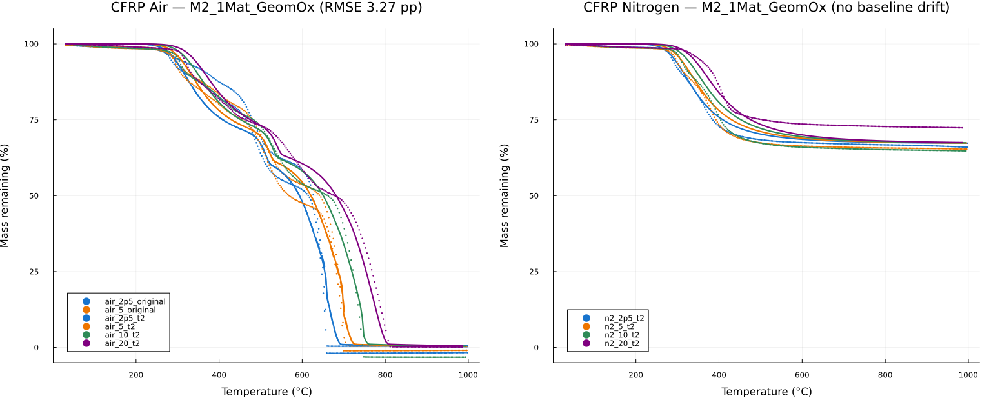
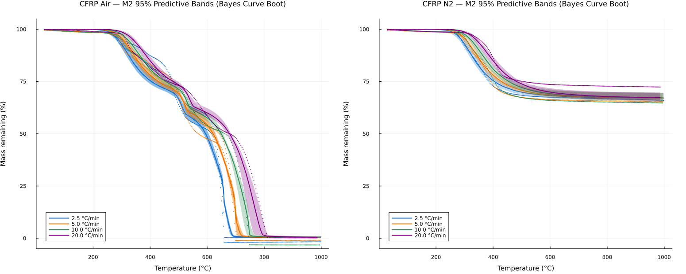
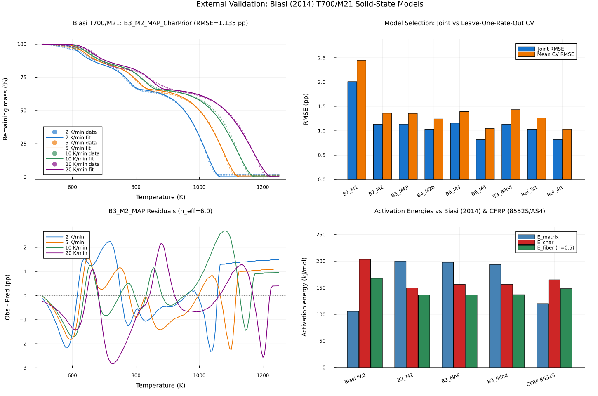
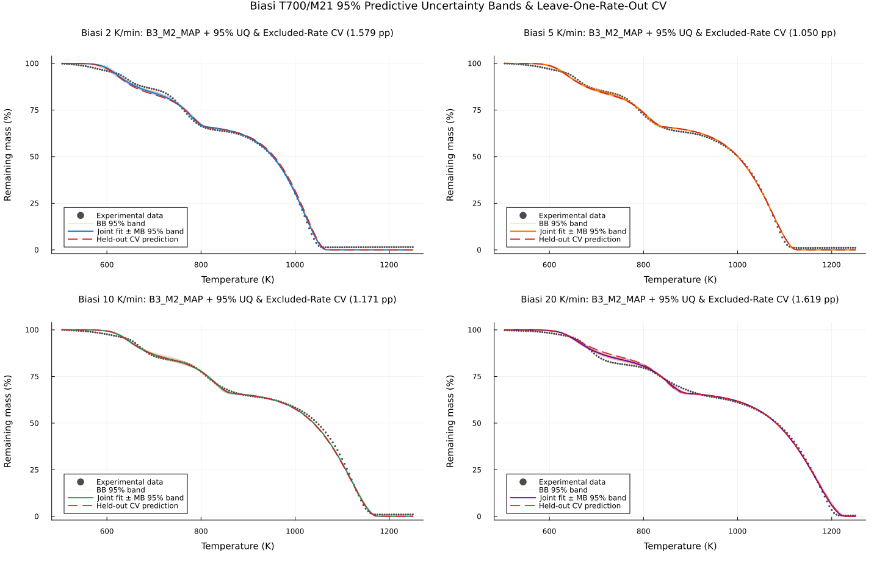
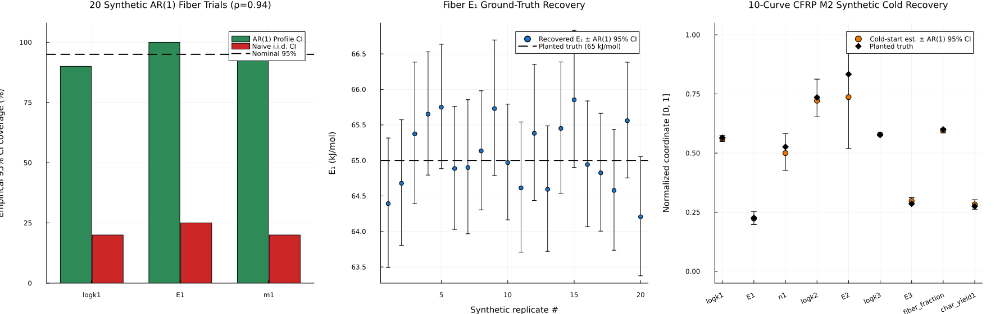
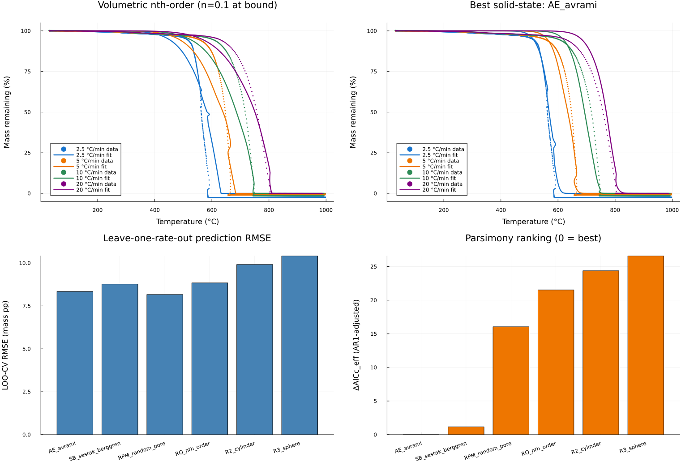
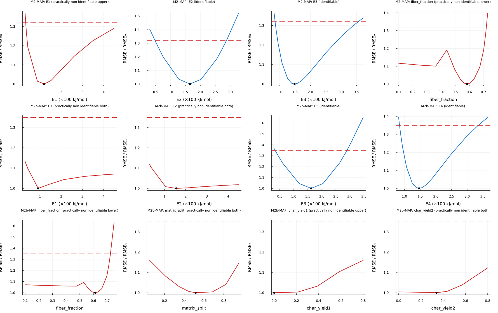
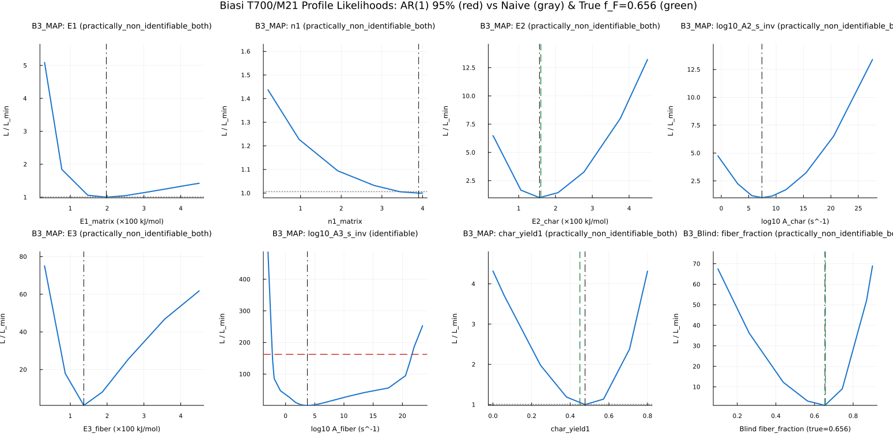

# CFRP Solid-State Inverse Kinetics & AR(1) Uncertainty Quantification

Single-method solid-state thermogravimetric analysis (TGA) inverse modeling, autocorrelation-aware maximum a posteriori (MAP) regularization, and external benchmark validation for carbon-fiber-reinforced polymer (CFRP) composites.

---

## Accuracy & Validation Summary

| Benchmark / Experiment | Model Variant | Joint RMSE | Out-of-Rate / Condition CV | Physical Composition & Kinetics | PEtab ODE Parity |
|---|---|---:|---:|---|---|
| **CFRP Multi-Condition (10 runs: 6 Air + 4 N2, 2.5–20 °C/min)** | `M2_MAP_CharPrior` (`k = 9`) | **`3.317 pp`** | **`3.911 pp`** (LOOCV) | `f_F = 0.5850`, `E_matrix = 120.15`, `E_char = 165.00` (ID), `E_fiber = 148.28 kJ/mol` (ID); `jac_cond = 107.7` (vs. `315.5` unreg.) | **`3.95e-05 pp`** |
| **Biasi (2014) T700/M21 External Benchmark (4 Air rates, `505–1250 K`)** | `B3_M2_MAP_CharPrior` (`k = 8`, fixed `f_F = 0.656`) | **`1.135 pp`** | **`1.355 pp`** (LORO CV) | Zero bound hits; `char_yield1 = 0.4766` (Biasi Table IV.2: `0.45`); `E_char = 156.40`, `E_fiber = 136.67 kJ/mol` | **`2.09e-05 pp`** |
| **Biasi (2014) T700/M21 (2-Population Matrix)** | `B4_M2b_2Mat1st_GeomOx` (`k = 11`) | **`1.031 pp`** | **`1.243 pp`** (LORO CV) | `E_matrix1 = 104.01 kJ/mol` (vs. Biasi Table IV.2: `105.5 kJ/mol`) | **`4.66e-05 pp`** |
| **Blind Composition Recovery (Air-only, uninformed `f_F`)** | `B3_MAP_BlindFiber` (`k = 9`, free `f_F`) | **`1.134 pp`** | **`1.434 pp`** (LORO CV) | Recovered **`f_F = 0.6539`** vs. true `0.6560` (**`0.21 pp`** error) | **`2.34e-05 pp`** |
| **Synthetic AR(1) UQ Calibration** | Fiber AE (`20` trials, `rho = 0.94`, `sigma = 1.5 pp`) & CFRP `M2` (`rho = 0.92`, `sigma = 1.0 pp`) | — | — | AR(1) 95% profile coverage: **`57/60 (95.0%)`** on Fiber AE and **`9/9 (100.0%)`** on CFRP `M2` (vs. Naive i.i.d. `21.7%` and `22.2%`) | Verified |

---

## Visual Proof of Predictive Accuracy

### 1. Multi-Condition CFRP Fits (`Air` + `N2`, 2.5–20 °C/min)
Joint solid-state fits across all 10 CFRP heating ramps and atmospheres, comparing candidate solid-state reaction topologies (`M1`–`M5`, `M2b`) and AR(1)-calibrated predictive uncertainty bands.



*Figure: Joint fits across the 10-run Air + N2 CFRP dataset (`M2_MAP_CharPrior` achieves `3.317 pp` joint RMSE and `3.911 pp` leave-one-condition-out CV RMSE while preventing runaway `E_char`).*



*Figure: Condition-wise `95%` Bayesian Curve Bootstrap and Moving-Block Bootstrap predictive envelopes capturing inter-ramp and repeat variance across Air and Nitrogen.*

### 2. Independent External Validation: Biasi (2014) T700/M21 Composite
Direct transfer of the methodology without changing reaction topology to published T700/M21 Air TGA curves (`2, 5, 10, 20 K/min`, `505–1250 K`), including genuine held-out Leave-One-Rate-Out CV curves and blind fiber-fraction recovery.



*Figure: Biasi (2014) T700/M21 multi-rate fits (`B3_M2_MAP_CharPrior`: `1.135 pp` joint RMSE, `1.355 pp` mean CV RMSE), cross-model CV comparison, residuals, and activation energy alignment against published Biasi Table IV.2 and CFRP.*



*Figure: Genuine held-out Leave-One-Rate-Out CV predictions (dashed red) overlaid on `95%` predictive uncertainty bands at `2, 5, 10,` and `20 K/min`.*

### 3. Synthetic Ground-Truth & AR(1) Calibration Verification
Because TGA residuals exhibit strong serial autocorrelation (`rho_1 > 0.90`), naive i.i.d. likelihood ratios severely under-cover true parameters. Adjusting the F-threshold by effective sample size `n_eff` restores nominal `95%` coverage.



*Figure: Synthetic ground-truth kinetic triplet recovery showing calibrated `95%` AR(1) profile coverage (`57/60 = 95.0%` Fiber AE; `9/9 = 100.0%` CFRP `M2`) versus overconfident naive i.i.d. intervals (`21.7%` and `22.2%`).*

<details>
<summary><strong>Additional Diagnostic Figures (Fiber Selection & AR(1) Profile Likelihoods)</strong></summary>

- **Fiber Oxidation Model Selection (R1–R3):**
  
- **CFRP `M2_MAP` vs `M2b_MAP` Profile Likelihoods:**
  
- **Biasi T700/M21 Profile Likelihoods & Blind `f_F` Identifiability:**
  

</details>

---

## Scope & Methodology

1. **Thermally-Centered Solid-State Kinetic Models (`src/solid_state/CFRPSolidState.jl`, `src/material_kinetics/solid_state.jl`):**
   - Multi-condition ODE forward simulation across Air (`O2`-dependent oxidation) and inert Nitrogen (`N2`) heating ramps integrated at `0.25 °C` steps using ForwardDiff-compatible RK4.
   - Five validated solid-state reaction topologies (`M1_1Mat_1stOrder`, `M2_1Mat_GeomOx`, `M2b_2Mat1st_GeomOx`, `M3_1Mat_RPMOx`, `M5_2Mat_FreeOrder_Cold`).
   - Exact equivalence verification against Catalyst/PEtab ODE solvers (`verify_cfrp_petab`, max discrepancy `< 1e-4 pp`).
   - Global-local hybrid optimization: Genetic Algorithm (`genetic_search.jl`) + Latin Hypercube multi-start `ForwardDiff` gradient + bounded `Fides.BFGS()`.

2. **Autocorrelation-Aware Uncertainty Quantification (`src/uncertainty/KineticUQ.jl`):**
   - Computes effective independent sample size `n_eff` from lag-1 residual autocorrelation (`rho_1`) and adjusts F-test profile-likelihood thresholds (`loss_ratio_f`).
   - Calibrates Gaussian MAP char-oxidation prior (`E_char = 160 ± 35 kJ/mol`) using AR(1) `data_loss / n_eff` weighting so prior strength scales properly with effective statistical degrees of freedom.
   - Quantifies parameter compensation (`E` vs `log10 A`), Bayesian Curve Bootstrap (BB), Moving-Block Bootstrap (MB), and automated identifiability guardrails (`src/material_kinetics/uq_reporting.jl`).

---

## Data Availability

- **Included Open Benchmark:** Published Biasi (2014) T700/M21 experimental curves (`data/biasi_t700m21/experimental_5K.csv`, `coverage.csv`) are included so both the Biasi validation suite (`scripts/run_biasi_validation.jl`) and the unit/integration test suite (`tests/runtests.jl`) run end-to-end out of the box.
- **Omitted Raw CFRP Curves:** Raw proprietary 10-curve CFRP TGA files are omitted from `data/cfrp_audited/` in this public repository; see [`data/cfrp_audited/README.md`](data/cfrp_audited/README.md) for the exact CSV schema to supply your own data via `--audit-folder=PATH`.
- **Included CFRP Comparisons & Tables:** All derived CFRP model-selection, kinetic triplet, AR(1) UQ, synthetic calibration, and Biasi cross-benchmark tables and figures remain preserved under [`results/cfrp_models/`](results/cfrp_models/) and [`results/biasi_comparison/`](results/biasi_comparison/Report.md).

---

## Repository Layout

```text
cfrp-solid-state-kinetics/
├── Project.toml, Manifest.toml & CondaPkg.toml  # Pinned Julia + Python/Fides env
├── run_cfrp_solid_state.jl                      # Production CFRP fit + CV + AR(1) UQ CLI
├── src/
│   ├── common.jl                                # Shared constants & Arrhenius utilities
│   ├── material_kinetics/                       # Solid-state laws, GA search, AICc, guardrails
│   ├── uncertainty/KineticUQ.jl                 # AR(1) n_eff, profile likelihood, BB & MB
│   └── solid_state/CFRPSolidState.jl            # CFRP + Biasi loaders, ODEs & PEtab checks
├── scripts/
│   └── run_biasi_validation.jl                  # Biasi (2014) T700/M21 benchmark & CV suite
├── data/
│   ├── biasi_t700m21/                           # Published Biasi T700/M21 experimental curves
│   └── cfrp_audited/README.md                   # Schema guide for user-supplied CFRP CSVs
├── results/
│   ├── cfrp_models/                             # CFRP CSV tables, UQ summaries & Fig01..Fig05
│   └── biasi_comparison/                        # Biasi CSV tables, Report.md & Fig06..Fig08
└── tests/
    └── runtests.jl                              # Standalone synthetic + Biasi + PEtab test suite
```

## Quick Start

```bash
# 1. Verify environment & run standalone synthetic-CFRP, Biasi, and PEtab test suite
julia --project=. -O1 tests/runtests.jl

# 2. Run external validation on published Biasi (2014) T700/M21 experimental data
julia --project=. -O1 scripts/run_biasi_validation.jl

# 3. Validate and run the CFRP pipeline on your own local audited CFRP folder
julia --project=. -O1 run_cfrp_solid_state.jl --audit-folder=/path/to/cfrp_data --check-inputs
julia --project=. -O1 run_cfrp_solid_state.jl --audit-folder=/path/to/cfrp_data
```
