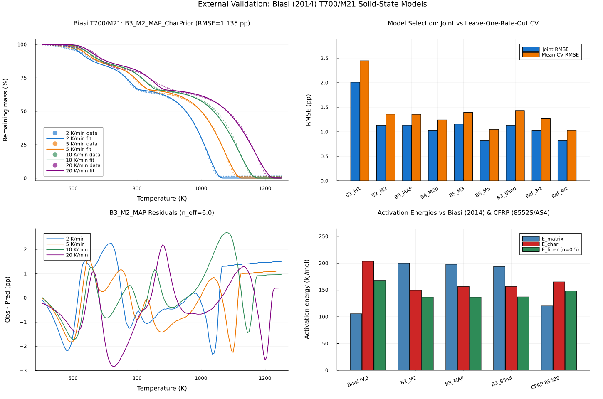
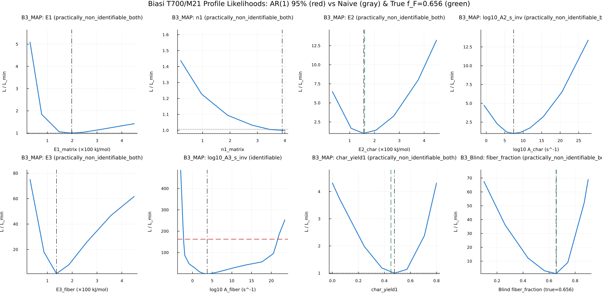
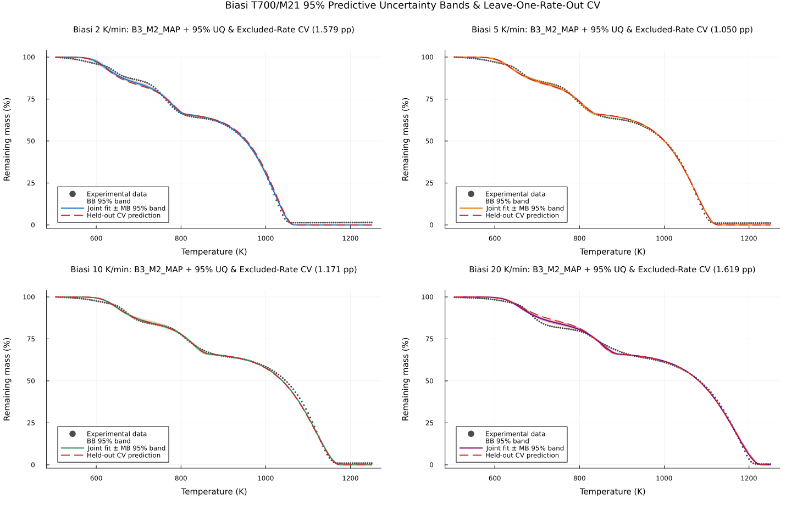

# External Validation: Published Biasi (2014) T700/M21 Benchmark

Applied our unified thesis methodology (**Hybrid `GA + ForwardDiff-BFGS` + Solid-State `M2_MAP` + `KineticUQ` + `Catalyst/PEtab` verification**) to the independent published T700/M21 Air dataset (`2, 5, 10, 20 K/min`, `505-1250 K`, true fiber mass fraction `0.656`).

## 1. Model Selection, Leave-One-Rate-Out CV & Blind Composition Recovery

| Variant | Model | k | Fixed Fiber | Joint RMSE (pp) | Mean CV RMSE (pp) | CV RMS (pp) | n_eff | AICc_eff | E_char (kJ/mol) | E_fiber (kJ/mol) | Fiber Frac | PEtab Gap (pp) | Bounds |
|---|---|---:|---|---:|---:|---:|---:|---:|---:|---:|---:|---:|---|
| B1_M1_1stOrder | M1_1Mat_1stOrder | 7 | true | 2.009 | 2.447 | 2.508 | 4.08 | 94.09 | 150.42 | 150.65 | 0.6560 | 2.13e-05 | none |
| B2_M2_GeomOx | M2_1Mat_GeomOx | 8 | true | 1.133 | 1.359 | 1.382 | 6.01 | 106.18 | 149.74 | 136.73 | 0.6560 | 1.90e-05 | none |
| B3_M2_MAP_CharPrior | M2_1Mat_GeomOx | 8 | true | 1.135 | 1.355 | 1.377 | 6.01 | 106.21 | 156.40 | 136.67 | 0.6560 | 2.09e-05 | none |
| B4_M2b_2Mat1st_GeomOx | M2b_2Mat1st_GeomOx | 11 | true | 1.031 | 1.243 | 1.272 | 7.48 | 217.53 | 143.71 | 137.55 | 0.6560 | 4.66e-05 | char_yield1 |
| B5_M3_RPMOx | M3_1Mat_RPMOx | 10 | true | 1.156 | 1.395 | 1.431 | 5.89 | 187.43 | 154.84 | 133.69 | 0.6560 | 5.95e-06 | psi2 |
| B6_M5_FreeOrder_Cold | M5_2Mat_FreeOrder_Cold | 15 | true | 0.817 | 1.048 | 1.081 | 5.22 | 459.80 | 150.50 | 133.77 | 0.6560 | 2.37e-06 | n2, char_yield1 |
| B2_BlindFiber | M2_1Mat_GeomOx | 9 | false | 1.132 | 1.370 | 1.393 | 6.03 | 143.99 | 149.72 | 137.04 | 0.6539 | 2.13e-05 | n1 |
| B3_MAP_BlindFiber | M2_1Mat_GeomOx | 9 | false | 1.134 | 1.434 | 1.471 | 6.03 | 144.02 | 156.47 | 137.00 | 0.6539 | 2.34e-05 | n1 |

## 2. Blind `fiber_fraction` Recovery (Air-Only, Uninformed Initial Composition)

- **`B3_MAP_BlindFiber`:** Recovered `fiber_fraction = 0.6539` (true `0.6560`, absolute error `0.0021` / `0.21 pp`); AR(1) 95% profile CI `[0.1000, 0.9000]` (practically_non_identifiable_both); MB bootstrap `[0.6440, 0.6641]`, BB bootstrap `[0.6384, 0.6566]`.

## 3. Cross-Benchmark Literature & CFRP Alignment

| Source | k | Joint RMSE (pp) | Mean CV (pp) | E_matrix (kJ/mol) | E_char (kJ/mol) | E_fiber (kJ/mol) | Fiber Frac |
|---|---:|---:|---:|---:|---:|---:|---:|
| Biasi (2014) Table IV.2 Air | - | - | - | 105.50 | 203.30 | 167.70 | 0.6560 |
| Free-order (three_route) | 10 | 1.031 | 1.267 | 193.91 | 154.64 | 133.56 | 0.6560 |
| Free-order (four_route) | 13 | 0.820 | 1.033 | 433.51 | 148.45 | 133.73 | 0.6560 |
| Biasi B2_M2_GeomOx | 8 | 1.133 | 1.359 | 200.13 | 149.74 | 136.73 | 0.6560 |
| Biasi B3_M2_MAP_CharPrior | 8 | 1.135 | 1.355 | 197.86 | 156.40 | 136.67 | 0.6560 |
| Biasi B4_M2b_2Mat1st_GeomOx | 11 | 1.031 | 1.243 | 104.01 | 143.71 | 137.55 | 0.6560 |
| Biasi B3_MAP_BlindFiber | 9 | 1.134 | 1.434 | 193.77 | 156.47 | 137.00 | 0.6539 |
| CFRP (8552S/AS4) M2_MAP_CharPrior | 9 | 3.317 | 3.911 | 120.15 | 165.00 | 148.28 | 0.5850 |

## 4. `B3_M2_MAP_CharPrior` (k = 8) Calibrated UQ & Guardrail Audit

- **Guardrail Status:** `warnings` | **Identifiable:** `2/11` | **BB:** `40/40` | **MB:** `40/40`

- **[WARNING] (`low_effective_dof`):** Effective sample size n_eff=6.0 is close to k=8 free parameters (< k+5); autocorrelation leaves minimal statistical degrees of freedom.
- **[WARNING] (`non_identifiable_params`):** Parameters not classified as identifiable under AR(1) profile likelihood: logk1, E1, n1, logk2, E2, E3, char_yield1, log10_A1_s_inv, log10_A2_s_inv
- **[WARNING] (`arrhenius_compensation`):** Severe Arrhenius (E, log10 A) compensation correlation (max |r|=0.9994 > 0.99).

| Parameter | Estimate | AR(1) 95% Profile CI | Block Boot 95% CI | Bayes Curve Boot 95% CI | Identifiability |
|---|---:|---|---|---|---|
| `logk1` | -2.5352 | [-7.0000, 1.5000] | [-2.6905, -2.4057] | [-2.6670, -2.4342] | practically_non_identifiable_both |
| `E1` | 1.9786 | [0.3000, 4.5000] | [1.5782, 2.4254] | [1.4239, 2.1219] | practically_non_identifiable_both |
| `n1` | 3.9040 | [0.2000, 4.0000] | [2.6853, 4.0000] | [2.8591, 4.0000] | practically_non_identifiable_both |
| `logk2` | -2.1907 | [-7.0000, 1.5000] | [-2.2618, -2.0839] | [-2.3073, -2.0805] | practically_non_identifiable_both |
| `E2` | 1.5640 | [0.3000, 4.5000] | [1.5106, 1.6640] | [1.5404, 1.5854] | practically_non_identifiable_both |
| `logk3` | -3.0674 | [-4.1944, -0.7415] | [-3.0799, -3.0601] | [-3.0760, -3.0624] | identifiable |
| `E3` | 1.3667 | [0.3000, 4.5000] | [1.3351, 1.3899] | [1.3558, 1.4116] | practically_non_identifiable_both |
| `char_yield1` | 0.4766 | [0.0000, 0.8000] | [0.4306, 0.5635] | [0.4335, 0.5341] | practically_non_identifiable_both |
| `log10_A1_s_inv` | 13.8694 | [-2.1956, 29.9344] | [10.5265, 17.6589] | [9.1384, 14.9783] | practically_non_identifiable_both |
| `log10_A2_s_inv` | 7.4201 | [-0.6134, 27.5880] | [7.0218, 8.0572] | [7.1875, 7.6620] | practically_non_identifiable_both |
| `log10_A3_s_inv` | 3.7315 | [-2.2664, 21.6445] | [3.5665, 3.8381] | [3.6820, 3.9460] | identifiable |

